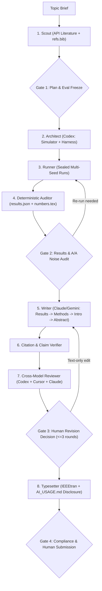

# Research Paper Factory

A deterministic-envelope, multi-agent academic research paper pipeline built for IEEE/ACM Software Engineering and Systems venues (ICSE, FSE, ASE, ISSTA, ICST, EuroSys, IEEE Software).

## Architectural Foundations (Industry Best Practices)

This pipeline synthesizes the proven design patterns across 13+ community systems and research frameworks:
- **File-Based Multi-Agent Handoff** (*Anthropic Multi-Agent Research*): Agents never pass raw research context via long conversational chains; every stage reads and emits versioned files (`plan.md`, `literature/refs.bib`, `runs/<run_id>/manifest.json`, `results/results.json`, `paper/generated/numbers.tex`, `reports/*.md`).
- **Deterministic Data Chaining** (*data-to-paper*): Zero hand-typed numbers in LaTeX. Every empirical figure traces via `runs/<run_id>/manifest.json` -> `results/results.json` -> `paper/generated/numbers.tex` -> `paper/main.tex`.
- **Sealed Final Evaluation** (*Agentic Scientist / AI Scientist v3*): Runs are sealed with SHA-256 checksums of metrics, harness, dataset, git commit, and seeds. Tampering blocks the build.
- **No Fabricated Revision Experiments** (*PaperOrchestra*): Simulated reviewers cannot fabricate or silently run unapproved experiments to game scores.
- **Cross-Model Peer Review** (*ARIS*): Writer and Reviewer are enforced by `factory/router.py` to belong to distinct model families.
- **Zero-Memory Citation Verification** (*bibverify / RefChecker / GhostCite*): Every BibTeX entry is sourced and verified against Crossref, OpenAlex, and arXiv APIs, with automated IEEE preprint-ratio monitoring.
- **Quota-Aware Multi-Model Orchestration**: Supports **Antigravity (Gemini 4 Neon)**, **Codex (GPT-6.2 Sol/Astra)**, **Cursor (Grok 4.7 / Composer 2.5)**, and **Claude (Opus/Sonnet 5.5)** with automatic quota-window routing (e.g., Claude automatically activates after its Saturday afternoon PST reset window `2026-11-28T15:00:00-08:00`, falling back gracefully before reset).

## Pipeline Topology & 4 Human Gates



## Quick Start

```bash
# 1. Inspect active multi-model routing (now vs. after Claude Saturday PST quota reset)
python3 -m factory.cli route
python3 -m factory.cli route --at 2026-11-28T16:00:00-08:00

# 2. Scaffold a new research topic repository
python3 -m factory.cli init \
  --dir ../semantic-speculative-merge-queue \
  --slug semantic-speculative-merge-queue \
  --title "Semantic Speculative Merge Queues: Graph-Disjoint Batching and Agentic Fault Attribution for High-Velocity CI" \
  --venue "ICSE / FSE / ASE (IEEEtran)"

# 3. Verify BibTeX against live scholarly APIs
python3 -m factory.cli verify-bib --bib ../my-topic/literature/refs.bib --report ../my-topic/reports/citation_report.md

# 4. Audit sealed runs
python3 -m factory.cli audit-runs --runs ../my-topic/runs

# 5. Generate IEEE/ACM AI Disclosure strictly from AI_USAGE.md
python3 -m factory.cli gen-disclosure --usage ../my-topic/AI_USAGE.md --out ../my-topic/paper/sections/ai_disclosure.tex
```

## Role Specifications (`agents/`)
See [`agents/ROLES.md`](agents/ROLES.md) and [`CLAUDE.md`](CLAUDE.md) for non-negotiable redlines, artifact contracts, and ACM SIGSOFT Empirical Standards checklists.
